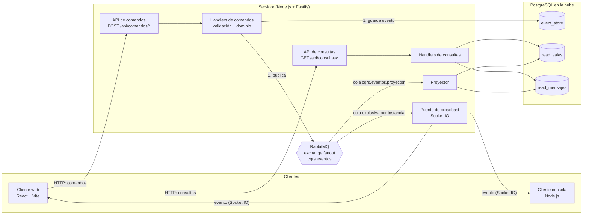
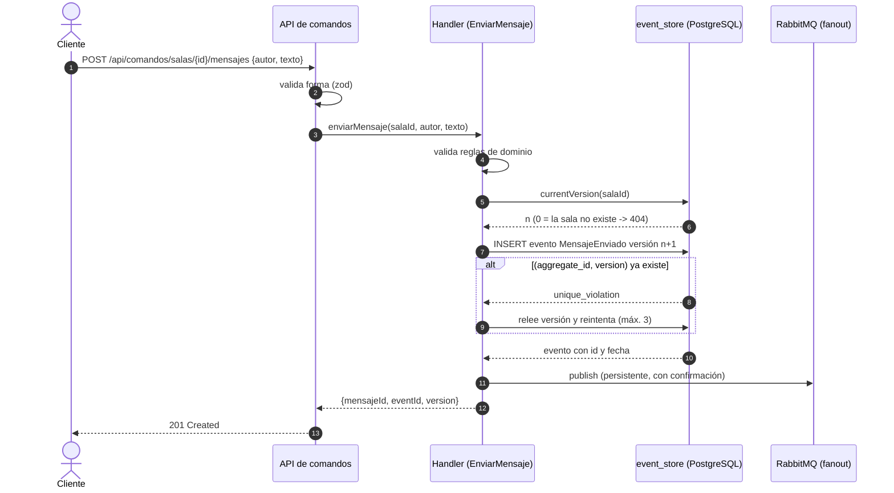
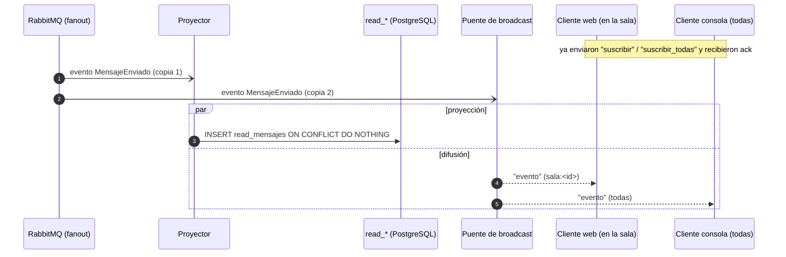

# Arquitectura

Aplicación de mensajería por salas que aplica **CQRS**: los *comandos* escriben, las *consultas* leen, y los dos lados
se comunican únicamente mediante **eventos de dominio** que se difunden por **broadcast**.

## 1. Componentes y responsabilidades

| Componente | Carpeta | Responsabilidad única |
|---|---|---|
| API de comandos | `server/src/api/commandRoutes.ts` | Recibir `POST`, validar la forma de la petición y delegar en un handler |
| Handlers de comandos | `server/src/commands/handlers.ts` | Reglas de dominio, guardar el evento y publicarlo |
| Event store | `server/src/events/eventStore.ts` | Guardar eventos de forma inmutable con concurrencia optimista |
| Definición de eventos | `server/src/events/events.ts` | Contrato (zod) de `SalaCreada` y `MensajeEnviado` |
| Publicador / consumidor | `server/src/messaging/rabbit.ts` | Hablar con RabbitMQ (exchange fanout) |
| Proyector | `server/src/projections/` | Convertir eventos en filas de las tablas de lectura (idempotente) |
| API de consultas | `server/src/api/queryRoutes.ts` | Recibir `GET` y delegar en handlers de consulta |
| Handlers de consultas | `server/src/queries/` | Leer solo las tablas `read_*` |
| Puente de broadcast | `server/src/broadcast/socketBridge.ts` | Reenviar cada evento de RabbitMQ a los clientes Socket.IO |
| Base de datos | `server/src/db/`, `server/migrations/` | Pool `pg` y migraciones SQL |
| Composición | `server/src/main.ts` | Arrancar solo los roles pedidos en `ROLES` |
| Cliente web | `clients/web/` | Enviar comandos, consultar y ver eventos en vivo |
| Cliente de consola | `clients/consola/` | Suscribirse al broadcast y mostrar eventos |

Los clientes **no importan código del servidor**: solo conocen el contrato HTTP y los eventos de Socket.IO
(cada cliente tiene su propio `contrato.ts`). El servidor no conoce a los clientes.

### Diagrama de componentes

## 2. Lado de escritura (comandos)

`Cliente → API de comandos → handler → validación → event_store → RabbitMQ (fanout)`

Cada comando valida primero (zod en el borde de la API; reglas de dominio —recorte de espacios, longitudes, existencia de
la sala— en el handler) y luego escribe un evento. El agregado es la **Sala**: `SalaCreada` es la versión 1 y cada
`MensajeEnviado` toma la siguiente versión. La restricción única `(aggregate_id, version)` implementa **concurrencia
optimista**: si dos mensajes compiten por la misma versión, uno recibe un conflicto y el handler relee y reintenta
(hasta 3 intentos; después responde `409`).

### Secuencia de un comando

## 3. Lado de lectura (consultas)

`RabbitMQ → proyector → tablas read_* → API de consultas → cliente`

El proyector consume de una **cola durable compartida** (`<exchange>.proyector`), por lo que cada evento se procesa una
sola vez aunque haya varias instancias del proyector. Las inserciones usan `ON CONFLICT DO NOTHING`: si RabbitMQ entrega un
evento dos veces (entrega "al menos una vez") o se republica con `npm run republish`, no se duplican filas.

## 4. Broadcast

`RabbitMQ → servidor (consumidor de broadcast) → Socket.IO → clientes suscritos`

Cada instancia del servidor crea una **cola exclusiva y temporal** enlazada al exchange fanout. Gracias al fanout, todas las
instancias reciben todos los eventos y cada una los reenvía a sus propios clientes; así el broadcast escala con varias
instancias.

Contrato de Socket.IO:

| Dirección | Evento | Argumentos | Efecto |
|---|---|---|---|
| cliente → servidor | `suscribir` | `salaId` (UUID), ack | Entra a la sala `sala:<id>` |
| cliente → servidor | `desuscribir` | `salaId`, ack | Sale de la sala |
| cliente → servidor | `suscribir_todas` | ack | Recibe los eventos de todas las salas |
| servidor → cliente | `evento` | evento de dominio | Notificación en vivo |

Reglas: `SalaCreada` se envía a **todos** los clientes conectados; `MensajeEnviado` se envía a los suscritos a esa sala y a
los suscritos a `todas`.

### Secuencia del broadcast

## 5. Consistencia eventual y su impacto

El `201` de un comando significa que el evento **ya está guardado** en `event_store`, no que ya esté en las tablas de lectura.
Entre ambos momentos pasan normalmente milisegundos, pero:

- Una consulta inmediatamente posterior a un comando puede **no mostrar todavía** el cambio.
- `GET /api/consultas/salas/{id}/mensajes` de una sala recién creada puede devolver `404` hasta que se proyecte `SalaCreada`.
- El broadcast no depende de las tablas de lectura: los clientes se enteran por el evento, normalmente antes de que la consulta lo refleje.
  Por eso el cliente web se suscribe (`suscribir_todas`) al conectar, **antes** de pedir el historial, y deduplica por `id` de mensaje.
- Si RabbitMQ no está disponible al publicar, el comando **no falla** (el evento está guardado); queda un registro de error en el
  log y la lectura/broadcast se recuperan con `npm run republish` (el proyector es idempotente). Limitación conocida: no hay
  patrón *outbox* automático; se documenta como mejora futura.
- Dentro de una sala el orden se conserva (cola FIFO + versiones por agregado). Si un mensaje se proyectara antes que su sala,
  fallaría la llave foránea, se reintentaría una vez y después se descartaría con log de error.

## 6. Ejecución por separado

`server/src/main.ts` arranca solo los roles de la variable `ROLES`:

| `ROLES` | Necesita | Hace |
|---|---|---|
| `api` | PostgreSQL + RabbitMQ | Comandos y consultas HTTP |
| `projector` | PostgreSQL + RabbitMQ | Mantiene `read_salas` y `read_mensajes` |
| `broadcast` | RabbitMQ | Socket.IO (no usa base de datos) |

Por defecto (`api,projector,broadcast`) corren juntos en un proceso; pueden separarse en tres procesos con puertos distintos.
